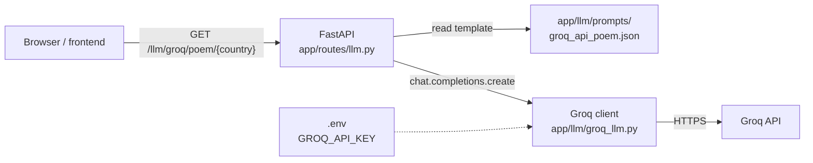

<div align="center">

# Groq FastAPI Example

**A minimal FastAPI backend that asks an LLM on Groq to write a poem about a country**


[Quick start](#quick-start) · [API](#api) · [How it works](#how-it-works)

</div>

This repository is a small starting point for course projects that want to call a hosted LLM from a Python backend.
It shows three things: keeping the API key out of the code, storing prompts as JSON templates, and exposing the
LLM call as a REST endpoint.

## Features

- 🔑 API key loaded from a `.env` file, never committed
- 📝 Prompt templates as JSON files with a `{country}` placeholder
- 🌐 One REST endpoint, `GET /llm/groq/poem/{country}`, with Swagger UI at `/docs`
- 🖥️ A standalone script that calls the same API without the server

> [!NOTE]
> Written in September 2024 as an example for the course *Interactive Visual Data Analysis* (IVDA) at the University
> of Zurich. The dependencies are pinned to that time. The project is not developed further; the only functional
> change since then is the model, because Groq shut down the original one (see [Known issues](#known-issues)).

> [!WARNING]
> Every request to the poem endpoint calls the Groq API with your key and counts against your Groq rate limits.

## Contents

- [Tech stack](#tech-stack)
- [How it works](#how-it-works)
- [Repository structure](#repository-structure)
- [Quick start](#quick-start)
- [Configuration](#configuration)
- [API](#api)
- [Development](#development)
- [Known issues](#known-issues)
- [Acknowledgements](#acknowledgements)
- [License](#license)
- [Author](#author)

## Tech stack

| Area | Technology |
|---|---|
| Backend |    |
| LLM |  |
| Tooling |   |

## How it works



1. A request comes in with a country, e.g. `/llm/groq/poem/Switzerland`.
2. The router loads [`groq_api_poem.json`](app/llm/prompts/groq_api_poem.json) and replaces `{country}` in each message.
3. The Groq client sends the messages to the chat completions API.
4. The router returns the first answer as `{"poem": "..."}`.

## Repository structure

| Path | Content |
|---|---|
| [`main.py`](main.py) | FastAPI app, CORS setup and the `/`, `/version` and `/fastapi-version` routes |
| [`app/routes/llm.py`](app/routes/llm.py) | The `/llm` router with the poem endpoint |
| [`app/llm/groq_llm.py`](app/llm/groq_llm.py) | Groq client, reads `GROQ_API_KEY` and `GROQ_MODEL` |
| [`app/llm/prompts/`](app/llm/prompts) | Prompt templates: `groq_api_poem.json` (API), `groq_poem.json` (script) |
| [`groq_example.py`](groq_example.py) | Standalone script that calls Groq once and prints the poem |
| [`.env.example`](.env.example) | Template for your `.env` |
| [`pyproject.toml`](pyproject.toml), [`uv.lock`](uv.lock) | Dependencies, locked to September 2024 |
| [`requirements.txt`](requirements.txt) | The same pinned versions for `pip` |

## Quick start

You need [uv](https://docs.astral.sh/uv/) (it installs Python 3.12 if needed) and a free Groq API key from
<https://console.groq.com/keys>.

1. Clone the repository:

    ```bash
    git clone https://github.com/HuberNicolas/groq-fastapi-example-uzh.git
    ```

    ```bash
    cd groq-fastapi-example-uzh
    ```

2. Install the dependencies:

    ```bash
    uv sync
    ```

3. Create your `.env`, then replace the placeholder with your key:

    ```bash
    cp .env.example .env
    ```

4. Start the server:

    ```bash
    uv run uvicorn main:app --reload
    ```

5. Open <http://localhost:8000/docs> and try `GET /llm/groq/poem/{country}`, or call it directly:

    ```bash
    curl http://localhost:8000/llm/groq/poem/Switzerland
    ```

To call Groq without the server, run the script from the repository root:

```bash
uv run python groq_example.py
```

Without uv, create a Python 3.12 virtual environment, install the dependencies with `pip install -r requirements.txt`
and run the same commands without `uv run`.

## Configuration

Both variables are read from `.env` in the repository root or from the environment.

| Variable | Default | Meaning |
|---|---|---|
| `GROQ_API_KEY` | – (required) | Your Groq API key. The app stops at startup if it is missing. |
| `GROQ_MODEL` | `openai/gpt-oss-20b` | Any chat model from <https://console.groq.com/docs/models> |

## API

| Method | Path | Response |
|---|---|---|
| `GET` | `/` | `{"Hello": "World"}` |
| `GET` | `/version` | Version of this app: `{"version": "0.1.0"}` |
| `GET` | `/fastapi-version` | Installed FastAPI version |
| `GET` | `/llm/groq/poem/{country}` | `{"poem": "..."}`, or `502` with the Groq error message in `detail` |

Swagger UI runs at `/docs`, ReDoc at `/redoc`. CORS allows all origins, which is fine for local development only.

## Development

| Task | Command |
|---|---|
| Lint | `uv run ruff check .` |
| Format | `uv run ruff format .` |
| Change the prompt | Edit [`app/llm/prompts/groq_api_poem.json`](app/llm/prompts/groq_api_poem.json) |
| Add an endpoint | Add a route to [`app/routes/llm.py`](app/routes/llm.py), or add a router in `app/routes/` and include it in [`main.py`](main.py) |

## Known issues

- Groq retires models regularly. The original model, `llama3-8b-8192`, was shut down on 2025-08-30, and its
  successor `llama-3.1-8b-instant` on 2026-08-16. If the endpoint returns `502` with `model_not_found` or
  `model_decommissioned`, set `GROQ_MODEL` to a current model from the
  [deprecations page](https://console.groq.com/docs/deprecations).
- `openai/gpt-oss-20b` is a reasoning model and takes a few seconds per poem.
- The country is inserted into the prompt as is, without validation.

## Acknowledgements

- Written while working as a student research assistant for Prof. Dr. Jürgen Bernard,
  [Interactive Visual Data Analysis Group](https://www.ifi.uzh.ch/en/ivda.html), Department of Informatics,
  University of Zurich, as an example for the IVDA course in fall 2024.
- [Groq](https://groq.com/) for the API and the [Groq Python SDK](https://github.com/groq/groq-python).

## License

[MIT](LICENSE). The dependencies keep their own licenses.

## Author

Nicolas Huber · [GitHub](https://github.com/HuberNicolas)
